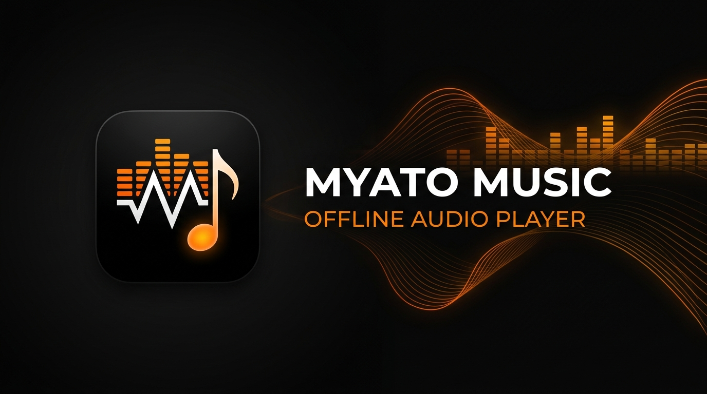
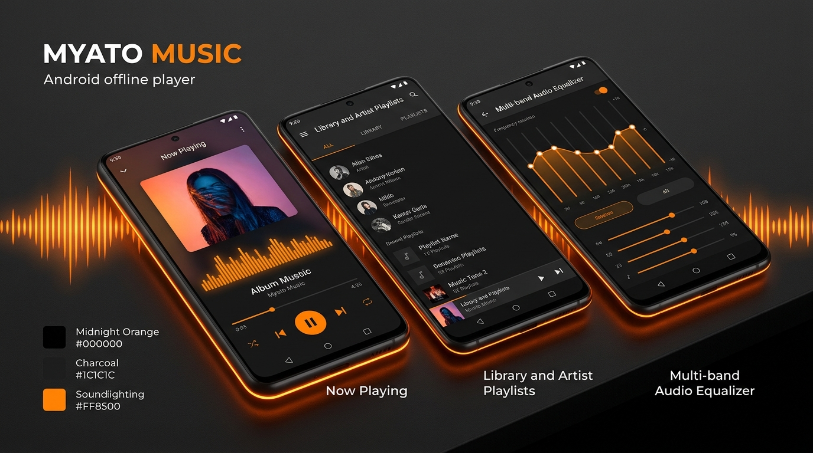
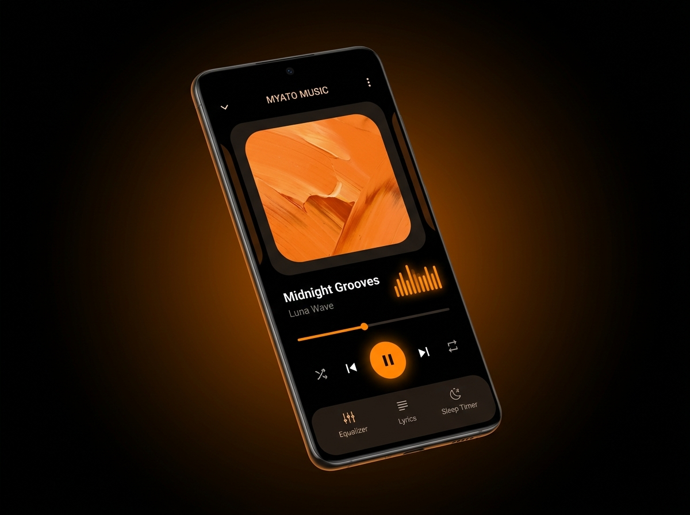
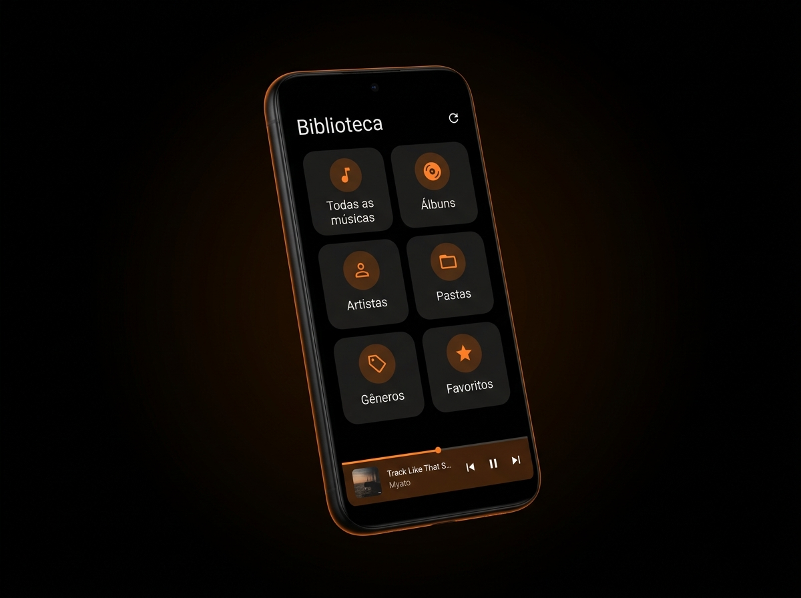
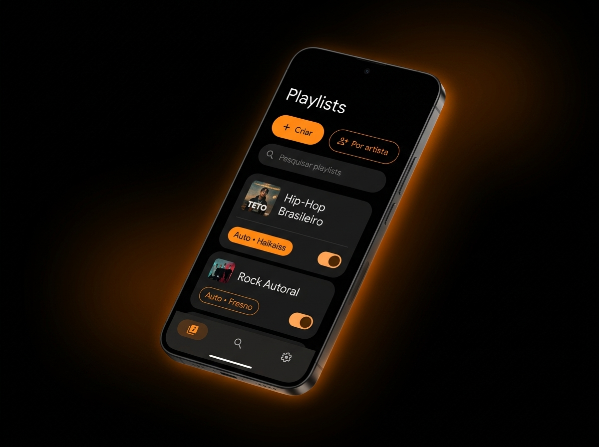
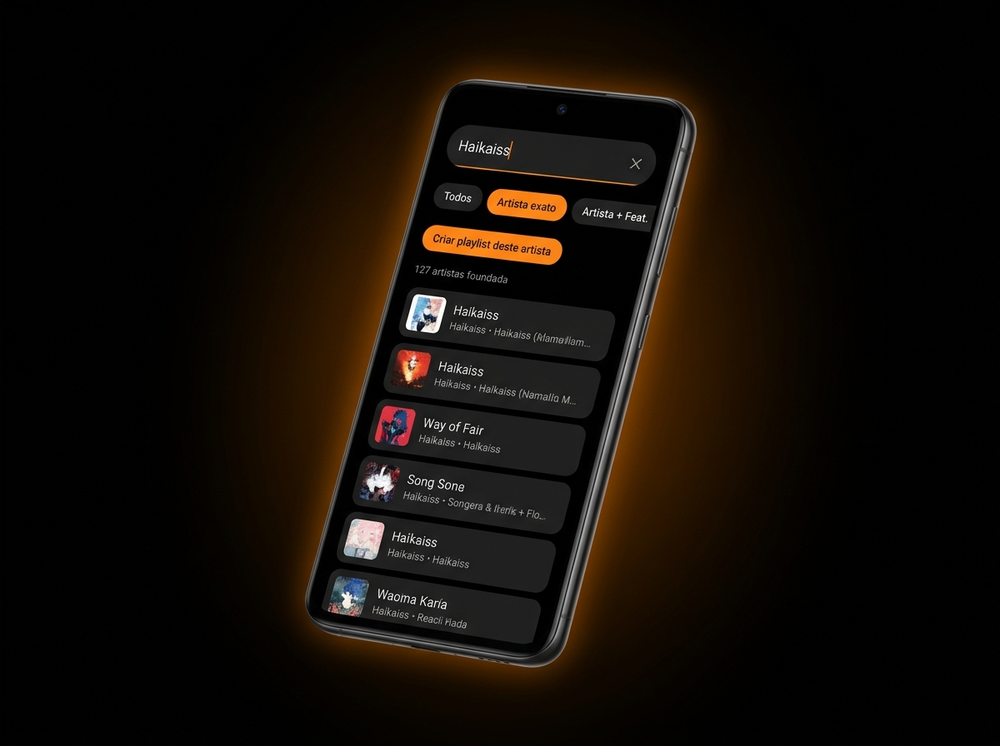

<p align="center">
  
</p>

<h1 align="center">MYATO MUSIC</h1>

<p align="center">
  <strong>Sua música. Seu estilo. Sua experiência.</strong><br/>
  Reprodutor musical Android <strong>100% offline</strong> construído nativamente em Kotlin, Jetpack Compose, AndroidX Media3 (ExoPlayer) e Room Database.
</p>

<p align="center">
  
  
  
  
  
</p>

<p align="center">
  <sub>Idioma atual: <strong>Português (Brasil)</strong> • Estrutura pronta para futura edição em inglês (<code>README.en.md</code>).</sub>
</p>

---

## ⬇️ Download do Aplicativo

<p align="center">
  <a href="https://github.com/medeiroshigor0709-byte/Myato-Player-v2/releases/latest/download/MYATO-MUSIC.apk">
    
  </a>
  <br/>
  <a href="https://github.com/medeiroshigor0709-byte/Myato-Player-v2/releases/latest">
    
  </a>
</p>

<!-- RELEASE_INFO_START -->
> **Status atual do download:** Nenhuma Release pública está publicada ainda em [`medeiroshigor0709-byte/Myato-Player-v2/releases`](https://github.com/medeiroshigor0709-byte/Myato-Player-v2/releases).
> - **Versão configurada no código (`app/build.gradle.kts`):** `1.0.0` (`versionCode = 1`) — *ainda não publicada como Release.*
> - **Tamanho e data do APK:** disponíveis automaticamente após a publicação da primeira Release.
> - **Como ativar o download direto:** publique a primeira Release criando e enviando uma tag (ex.: `git tag v1.0.0 && git push origin v1.0.0`) ou executando o workflow **Release MYATO MUSIC APK** (`.github/workflows/release.yml`). Assim que publicada, o botão **`⬇️ BAIXAR MYATO MUSIC — APK`** iniciará o download direto de `MYATO-MUSIC.apk` e este bloco será atualizado automaticamente com versão, tamanho e data.
<!-- RELEASE_INFO_END -->

---

## 📑 Índice

- [Apresentação](#-apresentação)
- [Privacidade Offline](#-privacidade-offline-obrigatória)
- [Funcionalidades Reais](#-funcionalidades)
- [Capturas de Tela e Conceito Visual](#-capturas-de-tela-ilustrações-conceituais)
- [Tecnologias Utilizadas](#-tecnologias-utilizadas)
- [Instalação no Android](#-instalação)
- [Estrutura do Projeto](#-estrutura-do-projeto)
- [Desenvolvimento e Publicação](#-desenvolvimento-e-contribuição)
- [Créditos e Licença](#-créditos-e-licença)

---

## 🎧 Apresentação

O **MYATO MUSIC** foi projetado para quem deseja controle total sobre sua coleção local de áudio sem depender de conexão com a internet, assinaturas, anúncios ou rastreamento.

Com interface escura de alto contraste baseada no tema padrão **Midnight Orange** (`#FF8500` / `#000000` / `#1C1C1C`), o aplicativo combina reprodução contínua via **Media3 ExoPlayer**, busca inteligente com separação rigorosa de artistas e participações, playlists automáticas por artista, múltiplas filas independentes, equalizador de hardware, editor de letras `.lrc` e gravador binário de tags ID3v2.3.

<p align="center">
  
</p>

---

## 🔒 Privacidade Offline Obrigatória

- **Zero permissão `INTERNET`** declarada no `AndroidManifest.xml` (verificado por teste automatizado em `MyatoRobolectricTests`).
- **Zero streaming, zero telemetria, zero anúncios e zero requisições de rede em segundo plano.**
- Acesso à mídia local respeitando Scoped Storage (`READ_MEDIA_AUDIO` no Android 13+ e `Storage Access Framework` via `DocumentFile`), além do **Android Photo Picker** (`PickVisualMedia`) sem permissão ampla de galeria para troca de capas.
- Todos os dados permanecem exclusivamente no dispositivo (banco Room local + `DataStore` + backups JSON exportáveis).

---

## ✨ Funcionalidades

### 🔎 Pesquisa Musical Inteligente & Filtro por Artista (`MusicSearchEngine`)
- Busca em **Título**, **Artista**, **Artista do Álbum (`Album Artist`)**, **Álbum** e **Gênero** com normalização Unicode NFD (ignorando maiúsculas, minúsculas, acentos e espaços extras).
- **Separação rigorosa de artista principal e colaborações** (`feat.`, `ft.`, `part.`, `with`, `&`, preservando duplas oficiais quando correspondem ao `Album Artist`), sem misturar artistas não relacionados nem inferir artistas por pasta ou gênero.
- Alternância entre os modos **`Todos`**, **`Artista exato`** e **`Artista + Feat.`**, exibição da contagem exata de resultados, botão de limpeza rápida e criação direta de playlist a partir do artista filtrado.
- Metadados ausentes são rotulados honestamente como **`Artista desconhecido`**, com atalho direto para correção no Editor de Tags.

### 📋 Playlists Inteligentes & Controle Manual Completo
- Criação de **playlists exclusivas por artista/banda**, adicionando apenas faixas atribuídas nos metadados sem duplicatas.
- Opções por playlist para **atualização automática** ao atualizar a biblioteca local e para **incluir ou excluir colaborações (`feat.`)**.
- Adição manual em duas etapas com **revisão prévia obrigatória** (nome da música e artista antes de confirmar), seleção múltipla, reordenação, remoção individual, edição de nome/capa via Android Photo Picker, duplicação e importação/exportação `.m3u`.

### 🎵 Reprodução Contínua & Motor Media3 (`MyatoPlaybackService`)
- Serviço em segundo plano com **`MediaLibraryService` + `MediaSession` + ExoPlayer** (*gapless playback*, controle de foco de áudio, botões de fone com múltiplo clique e suporte à árvore de mídia do **Android Auto**).
- Diagnóstico real de hardware via `MediaCodecList` verificando suporte nativo do aparelho para **MP3, M4A, WMA, FLAC, OPUS, AAC, ALAC, APE, DSF, WAV e OGG**.

### 🎛️ Equalizador Real, Letras LRC & Editor ID3v2.3
- **Equalizador real (`EqualizerEngine`)** com bandas de frequência do dispositivo (`android.media.audiofx.Equalizer`), Bass Boost, Virtualizer, Loudness Enhancer, Visualizer em tempo real e perfis automáticos por saída (alto-falante, cabo P2, Bluetooth).
- **Letras sincronizadas (`.lrc`)** com parser/editor linha a linha e ajuste de sincronia em milissegundos.
- **Editor de Tags (`TagEditorEngine`)** escrito em Kotlin puro para gravação real de tags **ID3v2.3** e capas embutidas, além de edição em lote e sincronização com MediaStore/Room.

### 🎨 Motor Visual, Fontes, Widgets & Produtividade
- **12 temas integrados** (*Midnight Orange*, *AMOLED Black*, *Neon Galaxy*, *Cyberpunk*, *Royal Gold*, *Pure Light*, *Ocean Blue*, *Forest Green*, *Crimson Red*, *Glass*, *Purple Night* e *Arctic Silver*), editor completo de temas, extração offline de cores da capa (`Palette`) e importação/exportação JSON.
- **48 arquivos `.ttf` empacotados** no app (`app/src/main/res/font/`) com personalização separada de fonte geral e decorativa, além de importação de fontes customizadas `.ttf`/`.otf`.
- **Múltiplas filas simultâneas** (incluindo filas com nomes idênticos), fila ativa isolada, mesclagem e duplicação.
- **3 Widgets para tela inicial** (Pequeno `2x1`, Médio `4x1` e Grande `4x2`), atalhos fixados, marcadores com timestamp, notas por música, **Timer de Sono** (por tempo, fim da faixa ou contagem de faixas), estatísticas com exportação CSV e backup/restauração JSON agendável via `WorkManager`.

---

## 🖼️ Capturas de Tela (Ilustrações Conceituais)

> **Nota de transparência:** As imagens abaixo são **ilustrações conceituais (mockups)** geradas a partir das telas, cores e rótulos reais do código-fonte do **MYATO MUSIC** (tema *Midnight Orange*), pois o ambiente em nuvem não executa capturas diretas em emulador.

| Player Completo | Biblioteca Musical |
| :---: | :---: |
|  |  |
| *Tela do reprodutor com capa, espectro de áudio em `#FF8500`, controles e atalhos para equalizador, letras e timer.* | *Central da Biblioteca com acesso offline a Todas as músicas, Álbuns, Artistas, Pastas, Gêneros e Favoritos.* |

| Playlists Inteligentes | Pesquisa Musical Inteligente |
| :---: | :---: |
|  |  |
| *Gerenciamento de playlists com criação por artista, selo `Auto • Artista` e controle de atualização automática.* | *Busca com normalização de texto, filtros `Todos`, `Artista exato` e `Artista + Feat.` e criação rápida de playlist.* |

---

## 🛠️ Tecnologias Utilizadas

Todas as dependências abaixo estão confirmadas em `gradle/libs.versions.toml` e `app/build.gradle.kts`:

| Camada | Tecnologias e Bibliotecas |
| :--- | :--- |
| **Linguagem & Build** | Kotlin `2.2.10`, Android Gradle Plugin `9.1.1`, KSP `2.3.5`, Java 11 bytecode target (JDK 21 na CI) |
| **Interface (UI)** | Jetpack Compose (BOM `2024.09.00`), Material 3, Material Icons Extended, Navigation Compose `2.8.9`, Edge-to-Edge |
| **Áudio & Mídia** | AndroidX Media3 `1.6.1` (`media3-exoplayer`, `media3-session`, `media3-common`), `android.media.audiofx.*` |
| **Persistência Local** | Room `2.7.0` (16 entidades, migração v2 → v3), DataStore Preferences `1.1.7`, Kotlinx Serialization `1.8.0` |
| **Armazenamento & Imagem** | MediaStore API, DocumentFile `1.0.1` (SAF), Android Photo Picker (`PickVisualMedia`), Coil Compose `2.7.0`, Palette KTX `1.0.0` |
| **Segundo Plano** | WorkManager `2.10.1` (backups automáticos locais), Kotlin Coroutines `1.10.2` |
| **Testes** | JUnit `4.13.2`, Robolectric `4.16.1`, Compose UI Test JUnit4, Kotlinx Coroutines Test `1.10.2` |

---

## 📲 Instalação

1. Clique no botão **`⬇️ BAIXAR MYATO MUSIC — APK`** no topo desta página (ou acesse a aba [**Releases**](https://github.com/medeiroshigor0709-byte/Myato-Player-v2/releases/latest) quando a primeira versão estiver publicada) e baixe o arquivo **`MYATO-MUSIC.apk`**.
2. Abra o arquivo `.apk` baixado no seu celular Android (**Android 7.0 Nougat / API 24 ou superior**).
3. **Instalação fora da Play Store:** como o APK é distribuído diretamente pelo GitHub Releases, o Android exibirá um aviso pedindo autorização em **Configurações → Instalar apps desconhecidos** para o navegador ou gerenciador de arquivos utilizado. Habilite apenas para concluir a instalação.
4. Ao abrir o **MYATO MUSIC**, conceda a permissão de leitura de áudio local (`READ_MEDIA_AUDIO` / armazenamento em versões antigas) ou importe pastas pelo Storage Access Framework (SAF).

> **Dica de atualização:** mantenha sempre o mesmo `applicationId` (`com.aistudio.myatomusic.kxmpzq`) e a mesma keystore de release para atualizar versões futuras preservando playlists, filas, temas e estatísticas locais.

---

## 📁 Estrutura do Projeto

```text
.
├── .github/workflows/
│   ├── android-build.yml            # CI de build, testes (testDebugUnitTest) e geração de artifacts APK
│   └── release.yml                  # Fluxo de publicação de Release com assinatura, APK direto e atualização do README
├── docs/
│   ├── download/index.html          # Redirecionador opcional via GitHub Pages para o APK da última Release
│   └── images/                      # Banner, imagem promocional e ilustrações conceituais usadas neste README
├── gradle/libs.versions.toml        # Catálogo central de versões e dependências
└── app/src/
    ├── main/
    │   ├── AndroidManifest.xml      # Permissões locais (sem INTERNET), PlaybackService, Receivers e Widgets
    │   ├── res/font/                # 48 fontes .ttf embutidas para customização tipográfica
    │   └── java/com/example/
    │       ├── MainActivity.kt      # Activity principal Edge-to-Edge e intents de áudio/atalhos
    │       ├── MyatoApplication.kt  # Inicialização do app, canais de notificação e banco
    │       ├── core/
    │       │   ├── audio/           # MyatoPlaybackService, PlaybackController, EqualizerEngine, SleepTimerManager
    │       │   ├── common/          # AudioFormatSupport (MediaCodecList), BackupWorker, TimeFormatter
    │       │   ├── database/        # MyatoDatabase (v3), Entities, Daos, EntityMappers, AppPreferencesStore
    │       │   ├── designsystem/    # 12 temas, Theme.kt, Type.kt, MyatoBrandLogo, Palette Extractor, Motion
    │       │   ├── metadata/        # MusicSearchEngine, LrcLyricsEngine, TagEditorEngine (ID3v2.3)
    │       │   └── storage/         # MediaStoreScanner, BackupManager, FileManagerRepository, CustomFontManager
    │       ├── data/repository/     # Repositórios de biblioteca, playlists inteligentes, filas, temas e estatísticas
    │       ├── domain/models/       # Modelos de domínio (faixas, playlists, buscas, temas, fontes, efeitos)
    │       ├── feature/             # Telas Jetpack Compose (home, library, player, playlists, queues, equalizer, lyrics, themes, statistics, filemanager)
    │       ├── presentation/        # MyatoMainViewModel, MyatoRootApp e navegação type-safe (MyatoRoutes)
    │       └── widgets/             # Providers dos widgets Pequeno, Médio e Grande + ações
    └── test/java/com/example/       # Testes unitários e Robolectric (54 testes automatizados)
```

---

## 👨‍💻 Desenvolvimento e Contribuição

### Executar localmente

Requisitos: **JDK 21** (ou JDK 17+), **Android SDK** (`platforms;android-36`, `build-tools;36.0.0`) e Android Studio atualizado.

```bash
# 1. Clonar o repositório
git clone https://github.com/medeiroshigor0709-byte/Myato-Player-v2.git
cd Myato-Player-v2

# 2. Executar testes unitários e Robolectric
./gradlew :app:testDebugUnitTest

# 3. Gerar o APK de Debug
./gradlew :app:assembleDebug
```

### Publicar uma nova Release com download direto do APK

O workflow `.github/workflows/release.yml` automatiza os testes, assinatura do APK de Release e publicação no GitHub Releases anexando **`MYATO-MUSIC.apk`**, **`MYATO-MUSIC-release.apk`** e **`MYATO-MUSIC-debug.apk`**:

1. Configure os 4 segredos do repositório em **Settings → Secrets and variables → Actions**:
   - `ANDROID_KEYSTORE_BASE64`
   - `ANDROID_KEYSTORE_PASSWORD`
   - `ANDROID_KEY_ALIAS`
   - `ANDROID_KEY_PASSWORD`
2. Incremente `versionCode` e `versionName` em `app/build.gradle.kts`.
3. Crie e envie uma tag semântica (ou dispare manualmente via **Actions → Release MYATO MUSIC APK**):

```bash
git tag v1.0.0
git push origin v1.0.0
```

Contribuições via *Pull Requests* são bem-vindas. Antes de abrir um PR, certifique-se de manter a política **100% offline** (sem adicionar permissão `INTERNET`) e garantir que `./gradlew :app:testDebugUnitTest` passe integralmente.

---

## 📄 Créditos e Licença

- **Autor / Mantenedor:** [@medeiroshigor0709-byte](https://github.com/medeiroshigor0709-byte)
- **Licença:** Este repositório ainda **não possui um arquivo `LICENSE` definido**. Caso pretenda redistribuir ou aceitar contribuições sob uma licença específica (ex.: MIT ou GPLv3), adicione um arquivo `LICENSE` na raiz do projeto.
